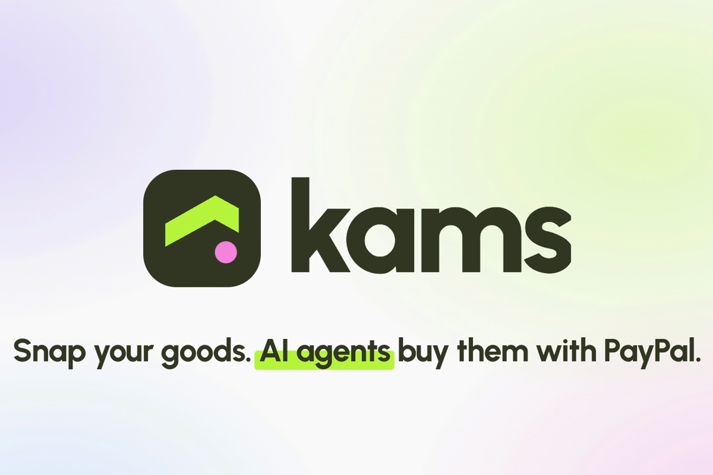
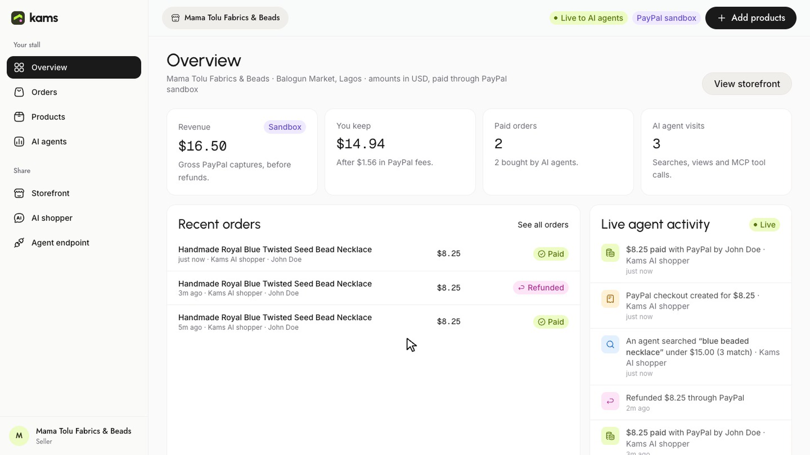
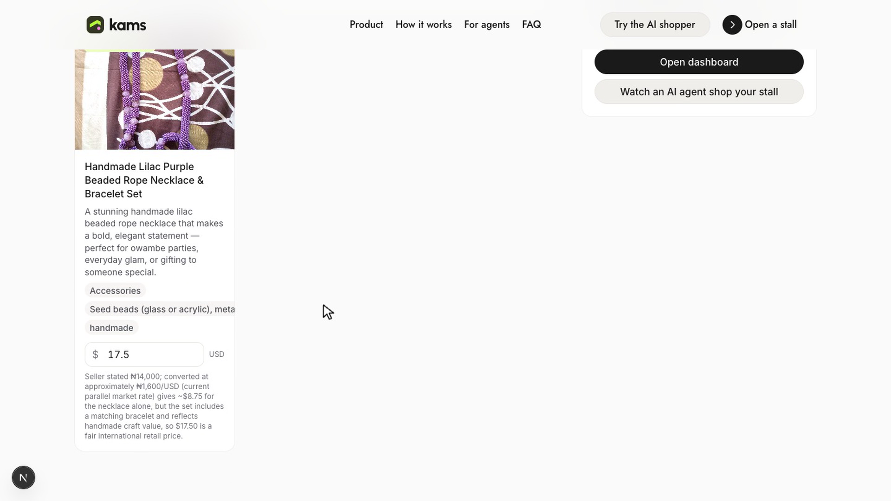
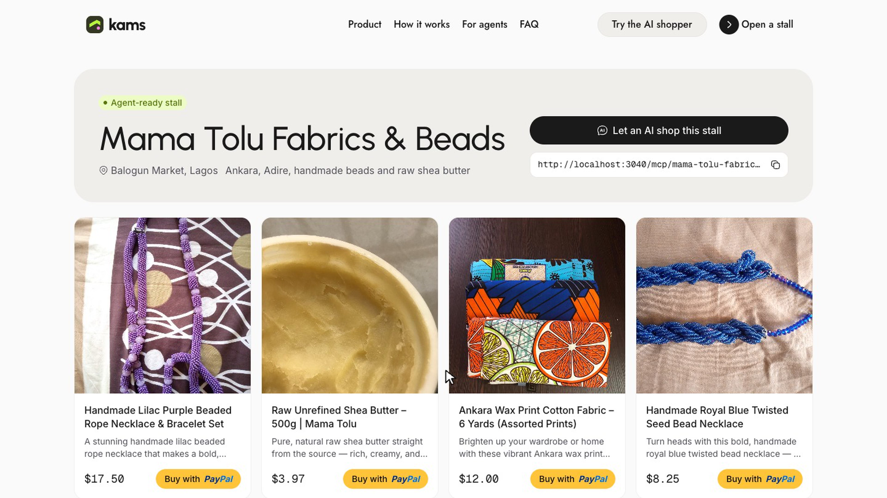
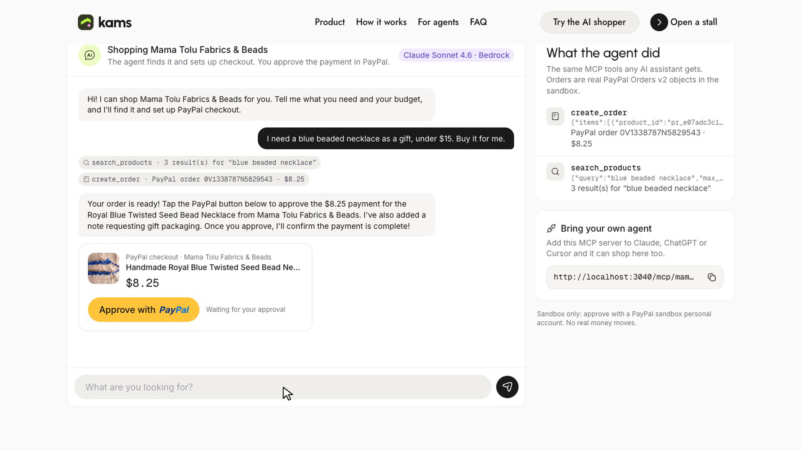
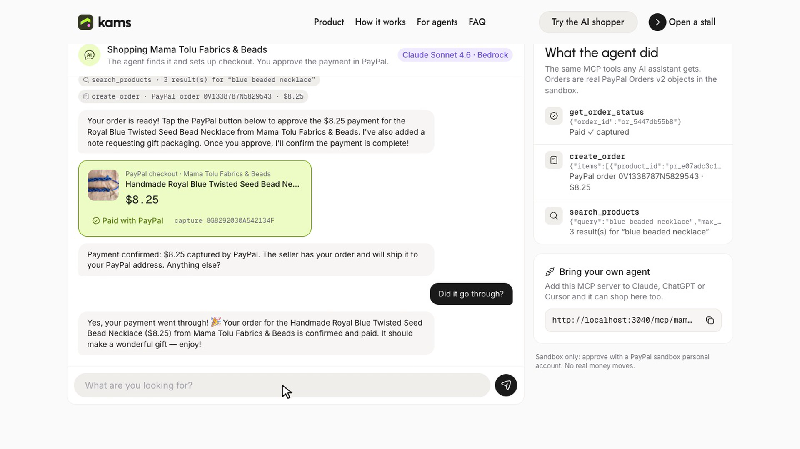
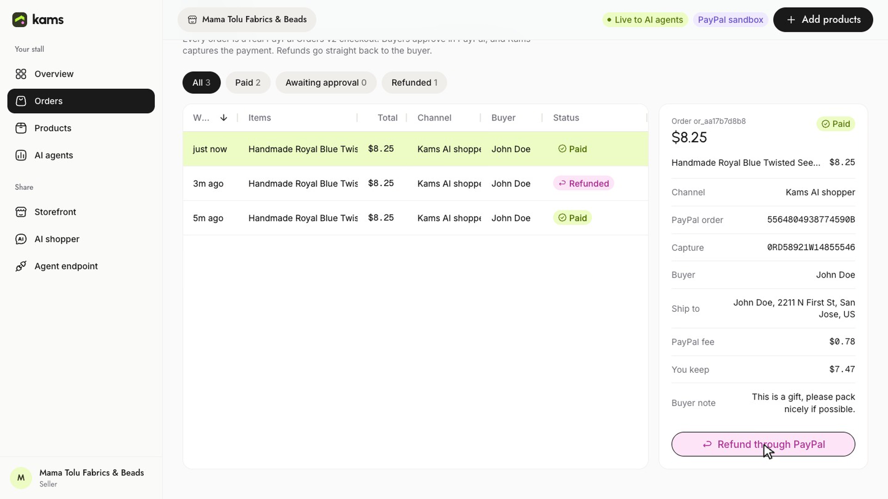

# Kams: Snap Your Goods, AI Agents Buy Them with PayPal

> Hundreds of millions of people sell on WhatsApp, Instagram and market stalls with no website. As shopping moves to
> AI assistants, these sellers become invisible. **Kams turns a few phone photos into a store that AI agents can
> search and pay for with PayPal, in about a minute.** Claude writes the listings, every stall is a live **MCP
> endpoint**, and every purchase is a real **PayPal Orders v2** checkout that a human approves.

Built for the **[PayPal AI Hackathon 2026](https://paypalaihackathon.devpost.com/)**.

---

## Live

- 🌐 **Live app**: https://www.usekams.xyz
- 🤖 **AI shopper**: https://www.usekams.xyz/shop
- 🛍️ **Example stall**: https://www.usekams.xyz/s/mama-tolu-fabrics-beads
- 🔌 **MCP endpoint**: `https://www.usekams.xyz/mcp` · **MCP docs**: https://www.usekams.xyz/docs
- 🎥 **Demo video**: https://youtu.be/0yZLBGHctXA
- 🗺️ **Architecture**: [`docs/kams-architecture.png`](docs/kams-architecture.png)
- 🧪 **Judges' sandbox login**: [Try it (judges)](#try-it-judges)

**Built with:** PayPal Orders v2 + Payments v2 (sandbox) · Claude Sonnet 4.6 on Amazon Bedrock · Model Context
Protocol · Next.js 16 · AG Grid · Node.js · Vercel + Docker

---

## Table of Contents

- [What it does](#what-it-does)
- [Try it (judges)](#try-it-judges)
  - [Connect your own agent over MCP](#connect-your-own-agent-over-mcp)
- [How AI and PayPal work together](#how-ai-and-paypal-work-together)
- [How we used PayPal](#how-we-used-paypal)
- [How we used AG Grid](#how-we-used-ag-grid)
- [Screenshots](#screenshots)
- [Architecture](#architecture)
- [Run locally](#run-locally)
- [AI tools used](#ai-tools-used)
- [Credits](#credits)
- [License](#license)

---

## What it does

1. **Snap.** The seller uploads product photos, optionally with a note like "₦18,000 per 6 yards, 100% cotton".
2. **Claude catalogs it.** Claude Sonnet 4.6 (vision, on Amazon Bedrock) writes the title, a fair USD price (converting
   local-currency notes), attributes, search tags and a factual description written for AI agents to read.
3. **Agent-ready instantly.** Every stall gets a storefront and a live **MCP endpoint**. Claude, ChatGPT, Cursor or any
   MCP client can connect and shop.
4. **Paid with PayPal.** An agent calls `create_order`, which creates an itemized **PayPal Orders v2** order. The buyer
   approves in PayPal, so a human stays in control of the money. Kams captures it, and the seller sees the order live
   with PayPal's fee and their net payout, and can refund it in one click through **Payments v2**.

## Try it (judges)

All payments use the **PayPal sandbox**: no real money moves.

1. Open the AI shopper at https://www.usekams.xyz/shop and ask, for example, *"I need a blue beaded necklace as a gift, under $15."*
2. Ask it to buy. Click the PayPal button it returns and log in with the sandbox buyer:
   - email: `sb-88lss53882238@personal.example.com`
   - password: `W!7i]j@=`
3. Approve. The chat confirms the payment once PayPal reports it captured.
4. Want the seller side? Create your own stall at https://www.usekams.xyz/new with any product photo. You'll land on your
   dashboard (orders, refunds, the agents that visited) and can buy from your own stall the same way.

Payments go to the US sandbox business account `sb-ex5yx50636695@business.example.com`, the owner of the PayPal REST app.
Each seller can set their own PayPal email in settings, and their orders are routed to it with the Orders v2 `payee` field.

### Connect your own agent over MCP

```bash
claude mcp add --transport http kams https://www.usekams.xyz/mcp
```

Any client that supports remote MCP (Streamable HTTP) can use `https://www.usekams.xyz/mcp` for every stall or
`https://www.usekams.xyz/mcp/<stall-slug>` for one stall. Tools: `list_stores`, `search_products`, `get_product`,
`create_order`, `get_order_status`.

## How AI and PayPal work together

| Step | AI | PayPal |
|---|---|---|
| Listing | Claude vision → title, price, attributes, agent-facing description (forced tool-use JSON) | — |
| Discovery | Agents call `search_products` / `get_product` over MCP | — |
| Checkout | Agent calls `create_order` | `POST /v2/checkout/orders`: CAPTURE intent, itemized, `payer-action` approval link, per-seller `payee` |
| Confirmation | Agent calls `get_order_status` and never claims "paid" before PayPal does | `GET /v2/checkout/orders/{id}` → `POST …/capture` with an idempotent `PayPal-Request-Id` |
| After the sale | Seller dashboard | `POST /v2/payments/captures/{id}/refund`; fee and net from `seller_receivable_breakdown`; webhooks are re-verified against PayPal |

The **built-in AI shopper** (`/shop`, `/s/<stall>/shop`) is Claude running a tool-use loop over exactly the same tool
definitions the MCP server exposes, so the demo follows the same path a third-party agent takes.

## How we used PayPal

Every payment in Kams is a real PayPal sandbox transaction, created and settled by server code (`server/paypal.js`). No AI model ever moves money.

| PayPal API | Where it's used | What it does in Kams |
|---|---|---|
| **OAuth 2.0** (`/v1/oauth2/token`) | every call | Client-credentials token, cached until it expires |
| **Orders v2 · create** (`POST /v2/checkout/orders`) | `create_order` tool (MCP, AI shopper, storefront) | CAPTURE intent, itemized lines (name, SKU, unit price from the catalogue), `reference_id` = Kams order, per-seller `payee`, `payer-action` approval link, `PayPal-Request-Id` idempotency |
| **Orders v2 · get** (`GET /v2/checkout/orders/{id}`) | `get_order_status`, return URL, webhook | Reads the real order state, so Kams never trusts a redirect or a webhook body on its own |
| **Orders v2 · capture** (`POST /v2/checkout/orders/{id}/capture`) | after the buyer approves | Captures once (`cap-<id>` idempotency key) across the return URL, agent polling and webhooks; stores the capture ID and payer |
| **Payments v2 · refund** (`POST /v2/payments/captures/{id}/refund`) | seller dashboard | One-click refund to the buyer (`ref-<id>` idempotency key), seller key required |
| **seller_receivable_breakdown** | seller dashboard | PayPal's fee and the seller's net payout per order |
| **Webhooks** (`/paypal/webhook`) | order and capture events | Treated as a hint: Kams re-reads the order from PayPal, then updates the dashboard |

The buyer always approves in PayPal (no card data touches Kams), and the agent only tells the buyer "paid" after PayPal reports the capture.

## How we used AG Grid

The seller's **Orders** page (`web/src/app/(app)/dashboard/[slug]/orders/page.tsx`) is built on **AG Grid** (`ag-grid-react` 32, Quartz theme restyled to the Kams design system):

- One row per PayPal order: when, items, total, channel (AI shopper, external MCP agent or storefront), buyer and status.
- **Custom cell renderers** show PayPal status as chips (Paid, Awaiting approval, Refunded); value formatters handle money and relative times.
- **`getRowId`-keyed rows** update in place as captures and refunds land, without re-mounting the grid.
- **Single-row selection** opens the order's PayPal details beside the grid: PayPal order ID, capture ID, buyer, ship-to, PayPal fee, the seller's net payout, the buyer's note, and a **Refund through PayPal** button.
- Status tabs (All, Paid, Awaiting approval, Refunded) filter the grid, and columns are sortable and resizable.

## Screenshots

| | |
|---|---|
|  |  |
|  |  |
|  |  |

Architecture diagram: [docs/kams-architecture.png](docs/kams-architecture.png).

## Architecture

```
seller photos ──► /api/stores/:slug/photos ──► Claude vision (Bedrock Converse, tool-use JSON) ──► catalog
                                                                                                │
AI agents ──► /mcp, /mcp/:slug (MCP Streamable HTTP, stateless) ──┐                             │
built-in shopper ──► /api/shop/chat (Claude tool loop) ───────────┼──► server/tools.js ◄────────┘
storefront ──► /api/stores/:slug/checkout ────────────────────────┘        │
                                                                           ▼
                                  PayPal Orders v2 create ─► buyer approves ─► capture ─► dashboard / refund
```

| Path | What it is |
|---|---|
| `server/tools.js` | Single source of truth for commerce tools (zod schemas → MCP and Bedrock tool specs) |
| `server/paypal.js` | Orders v2, capture, refunds, OAuth token cache, idempotency keys |
| `server/bedrock.js` | Bedrock Converse with an API key |
| `server/catalog.js` | Photo → listing |
| `server/agent.js` | Shopper agent loop |
| `server/mcp.js` | MCP server |
| `web/` | Next.js 16 + Tailwind 4: landing page, onboarding, storefront, AI shopper chat, seller dashboard (AG Grid orders table) |

**Hosting:** the web app runs on Vercel (www.usekams.xyz) and proxies `/api`, `/mcp`, `/paypal` and `/uploads` to the
API, which runs in Docker on a VPS behind HTTPS (api.usekams.xyz). See `Dockerfile` and `scripts/deploy-api.sh`.

## Run locally

Requires Node 20.9+, pnpm, a [PayPal sandbox app](https://developer.paypal.com/dashboard/applications/sandbox) and an
[Amazon Bedrock API key](https://docs.aws.amazon.com/bedrock/latest/userguide/api-keys.html) with access to Claude Sonnet 4.6.

```bash
npm install                      # API dependencies
cd web && pnpm install && cd ..  # web app
cp .env.example .env             # fill in your keys
```

```bash
# terminal 1: API (PayPal, Bedrock, MCP) on :3000
WEB_ORIGIN=http://localhost:3040 npm run dev:api
```

```bash
# terminal 2: web app on :3040, proxying to the API
cd web && pnpm dev
```

| Variable | Purpose |
|---|---|
| `PAYPAL_CLIENT_ID`, `PAYPAL_CLIENT_SECRET` | PayPal REST app (sandbox) |
| `AMAZON_BEDROCK_API_KEY` | Bedrock API key (bearer token) |
| `AWS_REGION` | Default `us-east-1` |
| `BEDROCK_MODEL_ID` | Default `us.anthropic.claude-sonnet-4-6` |
| `BASE_URL`, `WEB_ORIGIN` | Public web origin for links and PayPal return URLs |
| `API_ORIGIN` (web) | Where the Next.js app proxies API calls. Default `http://localhost:3000` |

## AI tools used

- **Claude Sonnet 4.6 on Amazon Bedrock** (Converse API): reading product photos, writing listings, suggesting prices and
  converting currency, and the shopping agent's reasoning and tool use.
- **Model Context Protocol** (`@modelcontextprotocol/sdk`): exposes each stall to external AI agents.
- **Claude Code** was used as a coding assistant while building the project.

## Credits

- The design system is adapted from [Spoke](https://usespoke.xyz), the author's earlier MIT-licensed project.
- Product photos on the example stall come from Wikimedia Commons:
  - [Ankara fabrics](https://commons.wikimedia.org/wiki/File:Ankara_fabrics.jpg) by Lyndadelz, CC BY-SA 4.0
  - [Stack of Adire](https://commons.wikimedia.org/wiki/File:Stack_of_Adire_,_a_local_Fabric_from_Abeoukuta.JPG) by Olaniyan Olushola, CC BY-SA 4.0
  - [Naturally Processed Shea Butter 2](https://commons.wikimedia.org/wiki/File:Naturally_Processed_Shea_Butter_2.jpg) by Dhee jah, CC BY-SA 4.0
  - [Necklace 2 2](https://commons.wikimedia.org/wiki/File:Necklace_2_2.jpg) and [Necklace 3](https://commons.wikimedia.org/wiki/File:Necklace_3.jpg) by Jeremyida002, CC0

## License

MIT, see [LICENSE](LICENSE).
